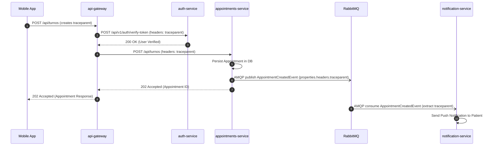

# CP1: Critical User Journey & Distributed Trace Map

## Critical User Journey
**Journey Name:** Patient Appointment Scheduling & Notification Flow
**Description:** A patient selects an available medical slot in the mobile app and requests a new appointment. The request passes through `api-gateway`, validates credentials with `auth-service`, persists the appointment in `appointments-service` (PostgreSQL), emits an event via `RabbitMQ`, and triggers an asynchronous patient notification via `notification-service`.

## Hop Table

| Step | Caller | Receiver | Protocol | Operation | Sync/Async | Data / Store |
| :--- | :--- | :--- | :--- | :--- | :--- | :--- |
| 1 | Mobile App | `api-gateway` | REST | `POST /api/turnos` | Sync | HTTP Payload (`patientId`, `slotId`, `specialty`) |
| 2 | `api-gateway` | `auth-service` | REST | `POST /api/v1/auth/verify-token` | Sync | Bearer Token Verification |
| 3 | `api-gateway` | `appointments-service` | REST | `POST /api/turnos` | Sync | `appointments` table (PostgreSQL) |
| 4 | `appointments-service` | `RabbitMQ` | AMQP | `publish(AppointmentCreatedEvent)` | Async | Queue: `appointments.events` |
| 5 | `notification-service` | `RabbitMQ` | AMQP | `consume(AppointmentCreatedEvent)` | Async | Dispatch SMS / Email notification |

## Sequence Diagram with W3C Trace Context Propagation



## Trace Span Tree

```text
trace_id: 4bf92f3577b34da6a3ce929d0e0e4736 (W3C traceparent context)
├── span: api-gateway:HTTP POST /api/turnos (root_span_id: 00f067aa0ba902b7)
│   ├── span: auth-service:HTTP POST /api/v1/auth/verify-token (parent_id: 00f067aa0ba902b7, span_id: 01a088bb1ca903c8)
│   └── span: appointments-service:HTTP POST /api/turnos (parent_id: 00f067aa0ba902b7, span_id: 02b099cc2db004d9)
│       ├── span: postgresql:INSERT INTO appointments (parent_id: 02b099cc2db004d9, span_id: 03c100dd3ec105ea)
│       └── span: rabbitmq:AMQP publish AppointmentCreatedEvent (parent_id: 02b099cc2db004d9, span_id: 04d111ee4fd206fb) [cross-boundary]
└── span: notification-service:AMQP consume AppointmentCreatedEvent (parent_id: 04d111ee4fd206fb, span_id: 05e122ff5ae307gc)
```
