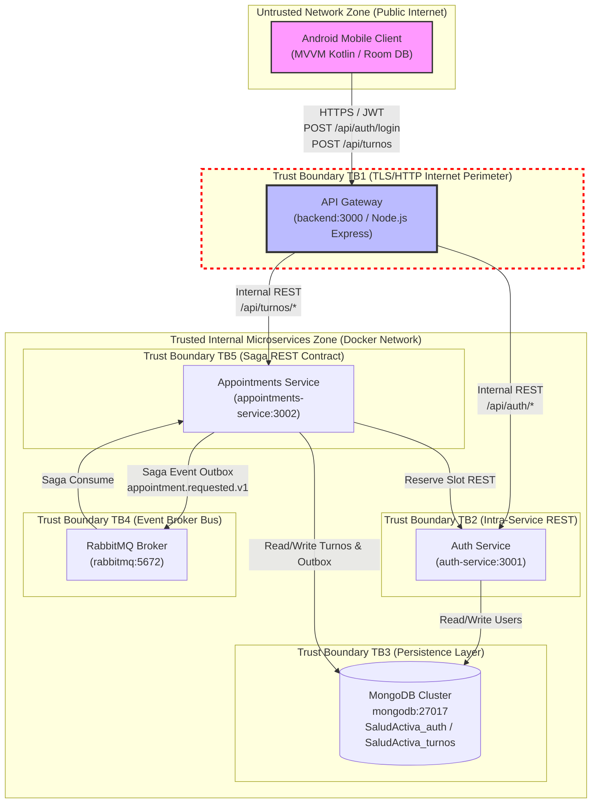

# CP1 — Attack Surface Map & Trust Boundaries

> **Author:** Brayan Yara (`@BrayanYara1`)  
> **System:** Salud Activa Ecosystem  
> **Claimed Trust Boundary:** `TB1: External Client (Android App) -> API Gateway (backend:3000)`

---

## 1. System Data Flow Diagram (DFD)

The diagram below maps all active services, message brokers, data stores, and external client entry points within the **Salud Activa** architecture. Trust boundaries are marked where data transitions between security zones.

---

## 2. Domain Asset Inventory

The table below classifies the primary domain assets handled by **Salud Activa** according to sensitivity and exposure.

| Asset ID | Asset Name | Description & Storage Location | Classification | Sensitivity Rationale |
| :--- | :--- | :--- | :--- | :--- |
| **AST-01** | User Credentials & Password Hashes | Argon2/Bcrypt password hashes stored in `SaludActiva_auth.users` MongoDB collection. | **Restricted** | Compromise leads to account takeover of patient medical records. |
| **AST-02** | JWT Bearer Tokens | Signed HS256 tokens issued by `auth-service` and cached in Android `EncryptedSharedPreferences`. | **Confidential** | Grants full API authorization to perform booking and profile management. |
| **AST-03** | Medical Appointment Records (`Turnos`) | Appointment details (patient ID, specialty, date, status) in `SaludActiva_turnos.turnos`. | **Confidential** | Patient Health Information (PHI) subject to statutory healthcare privacy regulation. |
| **AST-04** | Patient Health Records & Symptoms | Diagnostic logs and symptom history in `SaludActiva_health.records` and Android Room DB. | **Confidential** | Highly personal diagnostic data requiring strict confidentiality controls. |
| **AST-05** | Internal Service Pre-Shared Tokens | `SERVICE_TOKEN` environment variables used for gateway-to-service authentication. | **Restricted** | Allows bypassing client authentication if exposed publicly or logged. |

---

## 3. Entry Points Inventory for Claimed Boundary (TB1)

`TB1` represents the public perimeter exposed by the API Gateway (`backend:3000`). All client requests cross this boundary from untrusted mobile networks.

| Endpoint / Target | HTTP Method | Expected Payload / Params | Current Authentication | Primary Risk Vectors |
| :--- | :--- | :--- | :--- | :--- |
| `/api/auth/login` | `POST` | `{ email, password }` | Public (Unauthenticated) | Brute-force credential stuffing, SQL/NoSQL injection, DoS. |
| `/api/auth/register` | `POST` | `{ nombre, email, password, dni }` | Public (Unauthenticated) | Fake account creation, resource exhaustion, duplicate DNI probing. |
| `/api/turnos` | `POST` | `{ especialidad, fecha, medicoId }` | Bearer JWT Header (`Authorization`) | Token theft, parameter manipulation, booking race conditions. |
| `/api/turnos/usuario/:id` | `GET` | URL Parameter (`id`) | Bearer JWT Header (`Authorization`) | Broken Object Level Authorization (BOLA/IDOR), data leakage. |
| `/health/live` | `GET` | None | Public (Unauthenticated) | Reconnaissance, system fingerprinting, amplification attacks. |

---

## 4. Reflection Log (CP1)

### What I learned that I didn't know before:
I learned that mapping trust boundaries requires explicitly identifying where data crosses between different security control zones, rather than just drawing component diagrams. Differentiating between client-to-gateway perimeter boundaries and internal service-to-service transport is essential for threat modeling.

### How it applies to my project (Salud Activa):
In Salud Activa, the mobile app interacts with the Node.js API Gateway over `TB1`. While internal microservices (`auth-service` and `appointments-service`) reside in a Docker bridge network, `TB1` is publicly accessible and handles sensitive HTTP requests carrying JWT tokens and PHI appointment payloads.

### What I would fix first in the team's real code and what prevents it today:
I would implement strict payload validation schemas (such as Zod or Joi) at the Gateway entry point (`backend/server.js`). Today, raw JSON bodies are forwarded directly to microservices, creating potential parameter tampering risks.
