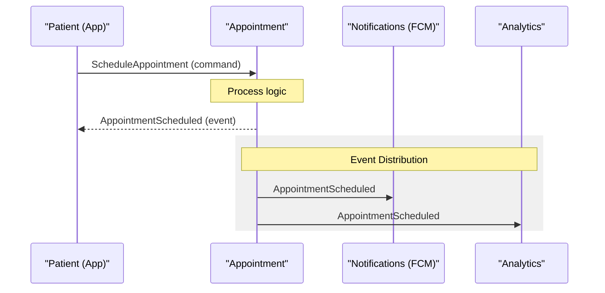

# Domain Events - Salud Activa

This document defines the asynchronous communication backbone of the **Salud Activa** (GestionTurnosApp) ecosystem. Domain events represent immutable facts that have occurred in our business processes.

---

##  What is a Domain Event?

A **Domain Event** communicates that something important occurred in the business. It is an immutable message that describes a fact in the **past tense**.

*   **✓ `AppointmentScheduled`**
*   **✓ `AppointmentCancelled`**
*   **✓ `MedicalRecordUpdated`**
*   **✓ `PatientRegistered`**

### Difference between Command and Event

| Concept | Intent | Tense | Can fail? |
| :--- | :--- | :--- | :--- |
| **Command** | Instruction to do something (intent) | Present | **Yes** (Validation can fail) |
| **Event** | Notification of a fact (occurred) | Past | **No** (It already happened) |

**Flow Example:**
`User (Android App) → [ScheduleAppointment] (Command) → Backend → [AppointmentScheduled] (Event) → Consumers (FCM/Analytics)`

---

##  Event Catalog

### Event: `AppointmentScheduled`

| Field | Value |
| :--- | :--- |
| **Name** | `AppointmentScheduled` |
| **Bounded Context** | `Appointments` |
| **Aggregate** | `Aggregate` |
| **Trigger** | A patient successfully books a medical slot in the app. |
| **Consumers** | `NotificationService` (FCM), `AnalyticsService`, `AuditLog`. |
| **Channel (Topic)** | `salud-activa.appointments.scheduled` |
| **Schema Version** | `v1` |
| **Delivery Guarantee** | **At-least-once** (Requires idempotency in consumers). |

**Payload Example:**
```json
{
  "eventId": "550e8400-e29b-41d4-a716-446655440000",
  "eventType": "AppointmentScheduled",
  "aggregateId": "appt-12345",
  "aggregateType": "Appointment",
  "occurredAt": "2026-08-23T19:30:00Z",
  "version": 1,
  "payload": {
    "patientId": "user-789",
    "doctorId": "doc-456",
    "specialty": "Cardiology",
    "appointmentDate": "2026-08-25T10:00:00Z",
    "clinicId": "central-clinic"
  },
  "metadata": {
    "correlationId": "corr-abc-123",
    "userId": "user-789"
  }
}
```

### Event Flow Visualization



---

##  Schema Evolution Strategy

Events are contracts. We follow strict rules to avoid breaking the Android App or Backend Services.

### Compatible Changes (Safe)
- Add a new optional field to the payload.
- Add a new event type.

### Incompatible Changes (Breaking)
- Remove a field from the payload.
- Change a data type (e.g., String to Number).
- Rename the event.

### Evolution Process
1. Publish **EventV2** alongside **EventV1**.
2. Migrate all consumers (App/Services) to **EventV2**.
3. Stop publishing **EventV1** after verification.

---

##  Event Resilience & Reliability

This section defines the strategies used to ensure that business events are processed reliably across the Salud Activa ecosystem, even during network instability.

### 1. At-Least-Once Delivery + Idempotency

Our message broker (SNS/SQS or RabbitMQ) guarantees that an event will be delivered at least once. To prevent side effects (like duplicate notifications), all consumers **MUST** be idempotent.

**Idempotent Consumer Implementation (Node.js Example):**

```typescript
/**
 * Idempotent consumer for Appointment events.
 * Safeguards against duplicate processing of the same business fact.
 */
async function processAppointmentScheduledEvent(event: AppointmentScheduled): Promise<void> {
  // 1. Check if the event was already successfully processed
  if (await eventStore.isProcessed(event.eventId)) {
    logger.info(`Event ${event.eventId} already processed. Skipping to avoid duplicates.`);
    return;
  }

  try {
    // 2. Execute business logic
    await medicalService.updateAgendaMetrics(event.payload);

    // 3. Mark as processed (ideally in the same DB transaction)
    await eventStore.markAsProcessed(event.eventId);
    
    logger.info(`Successfully processed event: ${event.eventType} [ID: ${event.eventId}]`);
  } catch (error) {
    logger.error(`Failed to process event ${event.eventId}: ${error.message}`);
    throw error; // Re-throw to trigger broker retry mechanism
  }
}
```

### 2. Dead Letter Queue (DLQ)

If an event fails repeatedly despite retries, it is moved to a Dead Letter Queue (DLQ). This prevents a single "poison pill" message from blocking the entire processing pipeline.

| Parameter | Recommended Value | Description |
| :--- | :--- | :--- |
| **Retries before DLQ** | 5 | Total attempts before giving up. |
| **Backoff Strategy** | Exponential | Delay: 1s -> 2s -> 4s -> 8s -> 16s. |
| **DLQ Retention** | 7 Days | Duration failed messages stay in DLQ. |
| **Monitoring Alert** | DLQ_Depth > 0 | Immediate alert to DevOps/Tech Lead. |

###  3. Operational Recovery

When a message lands in the DLQ:
1. **Analyze:** Inspect the event payload and failure reason.
2. **Fix:** Resolve the underlying issue (e.g., a database timeout or a code bug).
3. **Replay:** Move the message back to the primary queue for reprocessing once fixed.

---

##  Related Documentation
- **Microservice Runbook:** `docs/09-microservices/services/NN-service/runbook.md`
- **Error Handling Strategy:** `docs/00-governance/error-handling.md`
