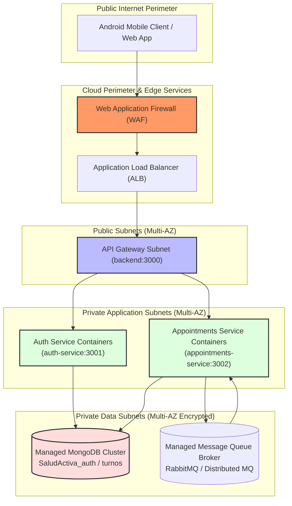

# Cloud Architecture Design Note — Salud Activa Ecosystem

> **Course:** Distributed Systems 2026-B · Corte 3 Certification  
> **Author:** Brayan Yara (`@BrayanYara1`) — Full Stack & DevOps Lead  
> **Date:** October 2026  
> **System:** Salud Activa — Distributed Medical Appointment Platform

---

## 1. Executive Summary & Migration Objectives

This architecture design note outlines the cloud redesign for **Salud Activa**, transitioning from the MVP 2 local Docker Compose runtime to a production-grade, multi-AZ cloud topology hosted on managed cloud infrastructure (AWS / Huawei Cloud).

### Key Architectural Goals
1. **High Availability & Fault Tolerance:** Multi-AZ container deployment guaranteeing 99.95% uptime for appointment scheduling.
2. **Elastic Auto-Scaling:** Dynamic horizontal pod/container scaling responsive to patient traffic bursts during clinic operating hours.
3. **Zero-Trust Security Perimeter:** Network isolation separating public API Gateway endpoints from private database subnets.
4. **Resilient Data Persistence:** Multi-region managed document and relational databases with automated snapshot backups.

---

## 2. Target Cloud Topology & Component Mapping

---

## 3. Component Specification & Managed Services

| On-Premises / Docker Local | Cloud Equivalent Service | Scalability & Resilience Strategy |
| :--- | :--- | :--- |
| `backend/server.js` (Express Gateway) | Cloud API Gateway / Managed Container Task | Auto-scales based on active HTTP connection count (10 to 100 tasks). |
| `auth-service` & `appointments-service` | Managed Container Service (ECS Fargate / CCE) | CPU/Memory auto-scaling policies across 3 Availability Zones. |
| `mongo:7.0` (Local MongoDB) | Managed DocumentDB / MongoDB Atlas Replica Set | Automated multi-AZ replication, continuous point-in-time recovery. |
| `rabbitmq:3.13` (Local Event Bus) | Managed Distributed MQ (RabbitMQ Cluster) | Mirror-queue durability across Availability Zones with automated failover. |

---

## 4. Operational Resilience, SLOs & Cost Optimization

* **Service Level Objectives (SLOs):**
  * Availability: `99.95%` monthly uptime.
  * Latency: P95 response time `< 200ms` for `POST /api/turnos`.
  * Recovery Objectives: RPO `< 5 minutes` (data loss limit), RTO `< 15 minutes` (recovery time).
* **Cost Optimization Policies:**
  * Auto-scaling down to minimum replica counts during off-peak night hours (23:00 to 06:00).
  * Utilizing spot container instances for non-critical background worker jobs (Outbox relay tasks).
