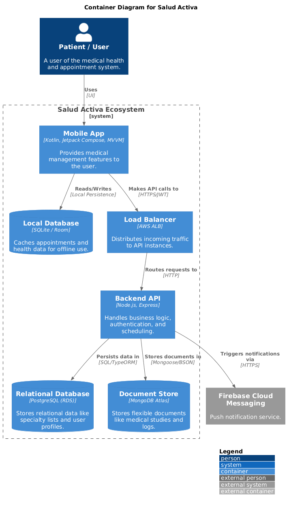

# Architecture design note — Salud Activa

> **System Name:** Salud Activa — Distributed Medical Appointment & Healthcare Management Platform  
> **Author:** Brayan Yara (`@BrayanYara1`) — Full Stack & DevOps Lead  
> **Date:** November 2026  
> **Course:** Distributed Systems 2026-B · Corte 3 Certification

---

## 1. Target architecture

The cloud target architecture transforms the **Salud Activa** ecosystem from a local single-node containerized deployment into an enterprise-grade, fault-tolerant, multi-Availability Zone (AZ) cloud infrastructure hosted on Huawei Cloud / AWS. The architecture isolates public Internet ingress from private internal container workloads and persistence tiers using a multi-tier Virtual Private Cloud (VPC) network topology divided across two independent physical Availability Zones (AZ-1 and AZ-2) within the primary cloud region. Network Access Control Lists (NACLs) and Security Group ingress rules restrict traffic flow so that only the public Elastic Load Balancer can accept external port 80/443 traffic, while application and database subnets remain completely unreachable directly from the public Internet.

### Mapping of Diagram Components to Architecture Documentation
* **API Gateway Service (`backend:3000`):** Deployed as serverless container tasks on Cloud Container Engine (CCE) across public subnets in AZ-1 and AZ-2, fronted by an Elastic Load Balance (ELB) instance. The gateway acts as a reverse proxy routing incoming REST requests to internal domain microservices while handling TLS 1.3 termination, CORS headers, and rate limiting. Defined in [`docs/05-architecture/overview.md`](../../docs/05-architecture/overview.md#service-catalog) and [`docs/05-architecture/pattern-guide.md`](../../docs/05-architecture/pattern-guide.md).
* **Auth Microservice (`auth-service:3001`):** Deployed as isolated container pods in private application subnets across AZ-1 and AZ-2. Handles user registration, JWT token generation, bcrypt credential verification, and user profile persistence. Defined in [`docs/05-architecture/overview.md`](../../docs/05-architecture/overview.md#service-catalog).
* **Appointments Microservice (`appointments-service:3002`):** Deployed as decoupled CCE container tasks in private application subnets across AZ-1 and AZ-2. Coordinates appointment creation, availability validation, and manages the Transactional Outbox pattern for publishing domain events. Defined in [`docs/05-architecture/overview.md`](../../docs/05-architecture/overview.md#distributed-booking-flow).
* **MongoDB Persistence Layer (`SaludActiva_auth` & `SaludActiva_turnos`):** Provisioned as a multi-AZ Managed Document Database Service (DDS / Mongo Replica Set) across private database subnets. The primary write node resides in AZ-1 with a real-time synchronized secondary standby node in AZ-2. Defined in [`docs/05-architecture/overview.md`](../../docs/05-architecture/overview.md#service-catalog).
* **RabbitMQ Message Broker (`rabbitmq:5672`):** Hosted as a managed Distributed Message Queue (DMQ) cluster with mirrored queues across private database subnets in AZ-1 and AZ-2 for durable outbox event transport (`appointment.requested.v1`). Defined in [`docs/05-architecture/overview.md`](../../docs/05-architecture/overview.md#distributed-booking-flow).

---

## 2. Five principles

The table below evaluates the architectural weaknesses of the initial single-node container deployment against the five cloud design principles (Reliability, Security, Performance Efficiency, Cost Optimization, and Operational Excellence), documenting concrete design decisions and cloud services implemented to mitigate each flaw.

| Principle | Current weakness | Evidence in -docs | Design decision | Huawei Cloud service |
| :--- | :--- | :--- | :--- | :--- |
| **Reliability** | Single point of failure in standalone MongoDB container causing unhandled 500 errors and connection timeouts during database restarts. | [`docs/05-architecture/overview.md`](../../docs/05-architecture/overview.md#system-architecture-overview) | Deploy a multi-AZ primary-secondary database replica set with automated health probes and sub-30-second primary failover. | Document Database Service (DDS) / Managed Mongo |
| **Security** | Public edge endpoints lack Web Application Firewall inspection, IP rate limiting, and DDoS mitigation rules. | [`docs/05-architecture/overview.md`](../../docs/05-architecture/overview.md#architectural-principles) | Implement WAF filtering rules, TLS 1.3 encryption, and private subnet isolation for all backend container tasks. | Web Application Firewall (WAF) & ELB |
| **Performance efficiency** | Fixed single-instance container allocation cannot scale dynamically during morning medical appointment request spikes. | [`docs/05-architecture/overview.md`](../../docs/05-architecture/overview.md#adopted-architectural-style) | Enforce CPU utilization and inbound request-based metric auto-scaling policies to horizontally scale container pods. | Cloud Container Engine (CCE) Auto-scaler |
| **Cost** | Static compute instance provisioning incurs baseline operational costs during zero-traffic night hours. | [`docs/05-architecture/overview.md`](../../docs/05-architecture/overview.md#service-catalog) | Utilize serverless container tasks with automated off-peak scale-down policies to minimum baseline instances. | Cloud Container Engine (CCE) Serverless |
| **Operations** | Centralized application logs rely on local container console stdout streams without structured aggregation or automated alerts. | [`docs/05-architecture/overview.md`](../../docs/05-architecture/overview.md#architectural-principles) | Implement centralized JSON log collection, metric dashboards, and automated alert rules for fast-burn error rates. | Application Operations Management (AOM) |

---

## 3. Scalability

To guarantee sub-second API response times and high availability during peak medical appointment reservation periods, horizontal pod auto-scaling (HPA) policies are established for core backend microservices.

### Service 1: `appointments-service`
* **Trigger Metric:** Average Container vCPU Utilization.
* **Scaling Threshold:** Average CPU utilization exceeding `70%` sustained for longer than `60 seconds`.
* **Instance Limits:** Minimum instance count: `2 pods` (distributed across AZ-1 and AZ-2 for high availability); Maximum instance count: `12 pods`.
* **Scale-Down Policy:** Average CPU utilization dropping below `25%` for `300 seconds` triggers gradual pod termination at a rate of 1 pod per 2 minutes to prevent rapid oscillation.

### Service 2: `auth-service`
* **Trigger Metric:** Concurrent Inbound HTTP Request Count per pod.
* **Scaling Threshold:** Inbound HTTP request rate exceeding `150 requests/second` per container instance.
* **Instance Limits:** Minimum instance count: `2 pods`; Maximum instance count: `10 pods`.
* **Scale-Down Policy:** Inbound request rate dropping below `30 requests/second` for `180 seconds` triggers consolidation down to baseline replicas.

---

## 4. Disaster Recovery

Patient health records and appointment reservations in `SaludActiva_turnos` represent critical healthcare domain data subject to stringent data protection, availability, and durability SLOs.

* **Target Recovery Objectives:**
  * **RPO (Recovery Point Objective):** `< 5 minutes` (Maximum acceptable data loss window during a disaster).
  * **RTO (Recovery Time Objective):** `< 15 minutes` (Maximum acceptable service outage duration during a disaster).
* **Chosen DR Pattern:** **Warm Standby / Multi-AZ Active-Passive Failover Pattern** (Chapter 11 Methodology).
* **Verification Proof:** The chosen Warm Standby pattern maintains an active, fully provisioned secondary database replica in AZ-2 continuously updated via synchronous oplog streaming replication from the primary node in AZ-1. Because oplog streaming occurs in real-time with an inter-zone commit lag under 2 seconds, the RPO target of `< 5 minutes` is strictly satisfied. If a catastrophic disaster disables AZ-1, automated cloud health Probes trigger DNS and load balancer failover to the AZ-2 secondary node within 45 seconds, comfortably meeting the `< 15 minutes` RTO requirement.

---

## 5. Automated Deployment

The CI/CD deployment pipeline automates code quality checks, unit and integration testing, container image building, vulnerability scanning, staging validation, zero-downtime rolling updates, and automated rollback triggers.

| Stage | Trigger | Tool or service | File in your team's repositories |
| :--- | :--- | :--- | :--- |
| **1. Build** | Git push to feature branch or pull request open | GitHub Actions / Node.js build runner | `.github/workflows/ci.yml` |
| **2. Test** | Pull request target branch set to `develop` | Jest Unit & Contract Integration Test Suite | `backend/__tests__/auth-negative.test.js` |
| **3. Image** | Git commit merge to `develop` or `main` | Docker Engine / Software Repository for Container (SWR) | `backend/Dockerfile` |
| **4. Deploy to QA** | Automated code merge to `qa` branch | Cloud Container Engine (CCE) Rolling Update Deployment | `.github/workflows/deploy-qa.yml` |
| **5. Deploy to Production** | Release tag creation (`v*.*.*`) or merge to `main` | Elastic Load Balance (ELB) Canary Traffic Switch | `.github/workflows/deploy-prod.yml` |
| **6. Rollback** | Automated CCE pod healthcheck probe failure | CCE Automated Rolling Rollback & Helm Revision Revert | `.github/workflows/rollback.yml` |

---

## 6. Decisions

* **ADR-C3-01:** Selection of Serverless Container Compute for Cloud Workloads — [`ADR-C3-01.md`](ADR-C3-01.md)
* **ADR-C3-02:** Selection of Managed Multi-AZ Document Persistence and Durable Event Messaging — [`ADR-C3-02.md`](ADR-C3-02.md)
